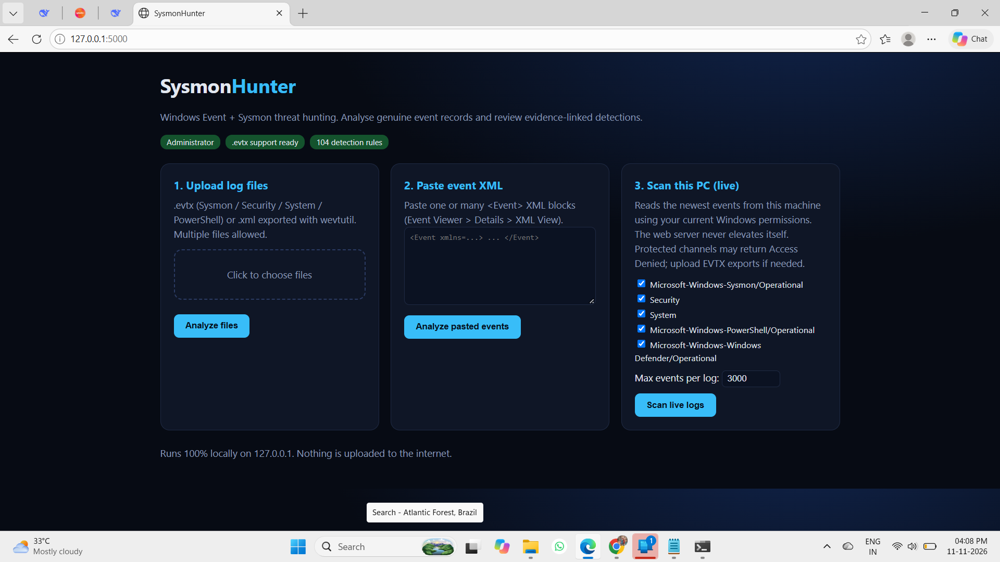
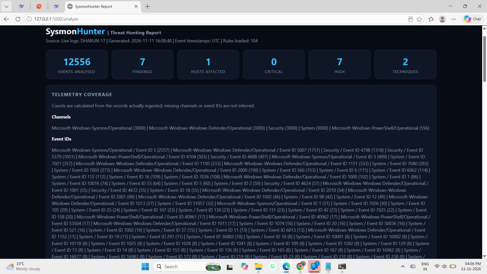
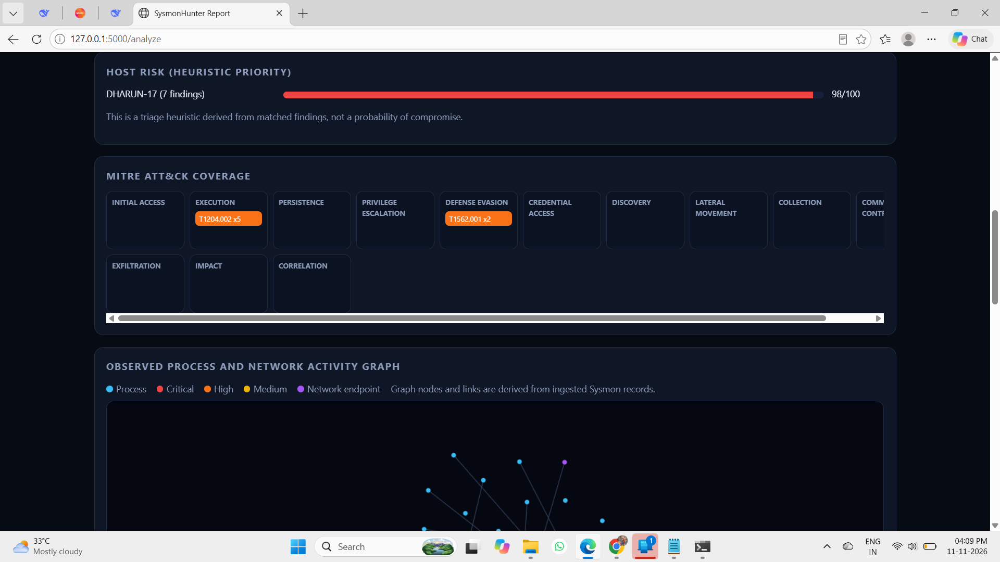
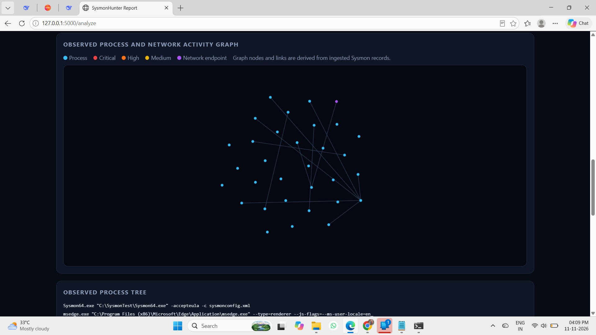
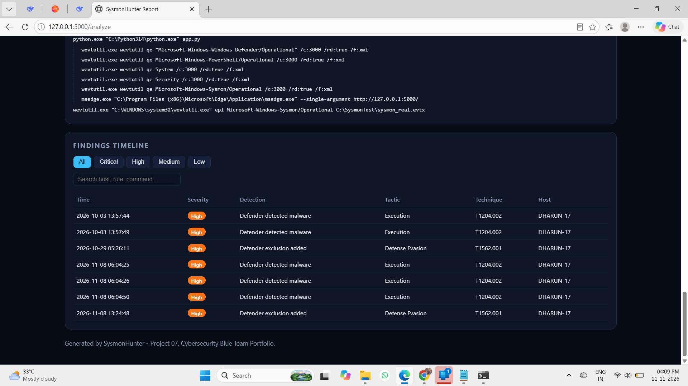
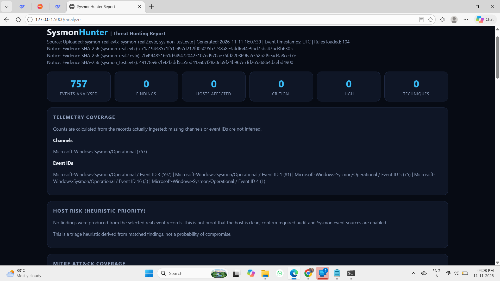

# SysmonHunter: Windows Event + Sysmon Threat Hunter


-lightgrey)

[](https://github.com/DharunS360/Cybersecurity-BlueTeam-Projects/actions/workflows/project-07-ci.yml)

A local Windows threat-hunting utility that turns **operator-supplied event records** (Sysmon, Security, System, PowerShell and Defender logs) into **MITRE ATT&CK-mapped investigative leads**, a correlated multi-stage verdict and exportable reports.

> **Important:** detections are rule-based leads, not proof of compromise. A clean result means only that no enabled rule matched the records collected. Validate every finding against full event context.

## Contents

1. [Features](#features)
2. [How it works](#how-it-works)
3. [Detection coverage](#detection-coverage)
4. [Telemetry requirements](#telemetry-requirements)
5. [Dependencies](#dependencies)
6. [Quick start](#quick-start)
7. [Analysing real data](#analysing-real-data)
8. [Sysmon setup](#sysmon-setup)
9. [CLI reference](#cli-reference)
10. [Security design](#security-design)
11. [Testing and validation](#testing-and-validation)
12. [Limitations](#limitations)
13. [Troubleshooting](#troubleshooting)
14. [Roadmap](#roadmap)

## Screenshots

Captured on the author's own Windows workstation with real Sysmon telemetry. The live scan used an elevated terminal to read the Security channel; the recommended path remains exporting an EVTX with an authorised account. Findings are investigative leads, not confirmed incidents.

**Web interface:** upload EVTX/XML, paste event XML, or scan live channels.



**Live scan summary:** 12,556 events from five channels, with per-channel and per-Event-ID telemetry coverage.



**Host risk and MITRE ATT&CK coverage:** all 7 findings in this run came from Windows Defender events (detections and exclusion changes).



**Observed process and network graph** derived from Sysmon records.



**Findings timeline** with severity filters and search.



**Evidence handling:** uploaded EVTX files are SHA-256 hashed. This run analysed 757 Sysmon events with no rule matches, and the report states that this does not prove the host is clean.



## Features

- **Three real-data inputs:** original `.evtx` files, Event Viewer XML (upload or paste) and live collection through the built-in `wevtutil`.
- **104 registered rule definitions** across 12 ATT&CK tactic columns, plus stateful analytics (brute force / password spraying, discovery bursts) and a multi-stage kill-chain correlation summary.
- **Evidence integrity:** SHA-256 hashes of every uploaded EVTX/XML file.
- **Reporting:** local HTML report (host risk, ATT&CK matrix, process tree, searchable timeline, 3D attack graph), plus JSON and CSV exports.
- **Hardened local web UI:** bound to `127.0.0.1`, per-session CSRF tokens, Fetch Metadata and loopback Host checks, request size limits, `defusedxml` parsing.
- **Honest output:** collection errors and missing channels are reported, never silently treated as "scanned".
- Does **not** block, quarantine or remediate anything. It is read-only analysis.

## How it works

```
 .evtx / XML / wevtutil (live)
            |
            v
   Parser + normaliser  ---->  common event schema (time, host, EID, channel, fields)
            |
            v
   Rule engine  ----->  stateless rules (process, registry, logon, DNS, driver, pipe ...)
            |            stateful analytics (brute force, discovery burst)
            v
   Correlation  ----->  multi-stage attack chain per host (3+ tactics / 30 min)
            |
            v
   Reports: HTML | JSON | CSV   (+ SHA-256 evidence hashes)
```

## Detection coverage

| Tactic | Example detections |
|---|---|
| Initial Access | Network/RDP logon from public IP, web server spawning shells, risky attachment drops, autorun.inf |
| Execution | Encoded/hidden PowerShell, Office or PDF reader spawning shells, WMIC, script host from user paths |
| Persistence | Scheduled tasks, Run keys, suspicious services, WMI subscriptions, IFEO / Sticky Keys backdoors |
| Privilege Escalation | UAC bypass, vulnerable or unsigned drivers, print spooler abuse, named-pipe impersonation |
| Defense Evasion | Log clearing, AMSI bypass, Defender tampering, timestomping, masquerading, obfuscation |
| Credential Access | LSASS access, DCSync, Kerberoasting / AS-REP roasting, NTDS / SAM theft, WDigest |
| Discovery | AD enumeration, network and system discovery, discovery-burst analytics |
| Lateral Movement | PsExec / WMI / WinRM / DCOM, admin shares, pass-the-hash heuristics |
| Collection | Archive staging, input capture, mailbox file collection |
| Command and Control | Tool download, RMM / tunnelling tools, DNS tunnelling heuristics, C2 named pipes |
| Exfiltration | Cloud exfiltration tooling, file-sharing DNS, removable media |
| Impact | Recovery inhibition, ransom notes, backup/DB service stops, miners |

List every rule with its technique and severity: `python hunter.py --rules`.

> The rule count is the number of registered definitions, not a claim of 104 independently validated attack detections. Several rules are heuristic.

## Telemetry requirements

Rules only fire when the matching telemetry exists.

| Data source | Needed for | How to enable |
|---|---|---|
| Sysmon (events 1, 2, 3, 6, 7, 8, 10, 11, 13, 17/18, 19-21, 22, 25) | Process, network, registry, driver, pipe, DNS rules | Install Sysmon + `sysmonconfig.xml` |
| Security 4688 + command line | Process rules without Sysmon | Audit "Process Creation" + include command line |
| Security 4624/4625/4648/4662/4698/4703/4768/4769/5145 | Logon, Kerberos, AD, task and share rules | Advanced audit policy (mostly on domain controllers) |
| System 7045, 104 | Service install, log cleared | Enabled by default |
| PowerShell 4104 | Script block detections | Enable Script Block Logging |
| Defender Operational | Defender tamper / detection rules | Present by default on Windows 10/11 |

## Dependencies

| Package | Purpose |
|---|---|
| Flask (>=3.1,<4) | Local web interface |
| python-evtx (>=0.7.4) | Reading `.evtx` files |
| defusedxml (>=0.7.1,<1) | Hardened XML parsing of untrusted event XML |
| `wevtutil` (Windows built-in) | Live event log collection |

Requires **Windows 10/11** and **Python 3.11+**. Administrator rights are not needed to start the app or analyse EVTX exports.

## Quick start

```powershell
py -3 -m venv .venv
.\.venv\Scripts\Activate.ps1
python -m pip install --upgrade pip
pip install -r requirements.txt
python app.py
```

Or double-click `run_gui.bat`, which does the same. Open **http://127.0.0.1:5000** (use this exact address; the app enforces same-origin and loopback checks). Run as your normal user. Do not run the web server as Administrator.

## Analysing real data

**Option A: original EVTX (recommended for evidence).** In Event Viewer (`eventvwr.msc`) open the channel, choose *Save All Events As...*, then upload the `.evtx`. Keep the original file untouched. Multiple files are supported.

**Option B: live scan.** Select channels and an event limit in the *Scan this PC (live)* panel. Access is limited to the current account's permissions. Denied channels (for example Security) are reported as collection notes. Export those to EVTX with an authorised account instead.

**Option C: Event Viewer XML.** Open an event, *Details*, *XML View*, then paste the complete `<Event>...</Event>`.

For validation against known attack behaviour, use publicly available labelled EVTX datasets (for example the `EVTX-ATTACK-SAMPLES` project on GitHub) in an isolated lab.

## Sysmon setup

Sysmon is optional for Security/System/PowerShell logs but required for Sysmon-specific detections.

1. Download Sysmon from the official Microsoft Sysinternals page.
2. Review `sysmonconfig.xml` and confirm its schema version matches your Sysmon binary.
3. Inspect the current configuration, then apply from an **elevated** PowerShell:

```powershell
.\Sysmon64.exe -s
.\Sysmon64.exe -accepteula -i .\sysmonconfig.xml   # first install
.\Sysmon64.exe -c .\sysmonconfig.xml               # update existing install
```

Applying a configuration changes system telemetry. Review it first.

- Sysmon overview: https://learn.microsoft.com/en-us/sysinternals/downloads/sysmon

## CLI reference

```powershell
python hunter.py --rules                                  # list rules
python hunter.py --evtx "C:\Logs\Security.evtx" "C:\Logs\Sysmon.evtx"
python hunter.py --live --max 3000                        # supported live channels
```

HTML, JSON and CSV outputs are written to `reports/`.

## Security design

- Binds only to `127.0.0.1`; not intended for LAN or internet exposure.
- Session-bound CSRF tokens, Fetch Metadata cross-site rejection, loopback Host validation, exact-origin checks and request size limits.
- `defusedxml` for uploaded/pasted XML and EVTX record XML.
- Temporary EVTX copies are deleted after processing; no data leaves the machine.
- Reports may contain usernames, hostnames, IPs and command lines. Protect and redact before sharing.

## Testing and validation

```powershell
python -m unittest discover -s tests -v
```

Regression tests cover unique rule IDs, severity values, tactic metadata, empty input, a process-rule match and a benign non-match. CI runs them on Windows for Python 3.11 and 3.12.

Unit tests do **not** certify detection accuracy. Measure precision and recall on authorised, analyst-labelled datasets before relying on the output operationally.

## Limitations

- Findings are leads, not confirmed incidents. Severity is a triage priority, not a probability.
-