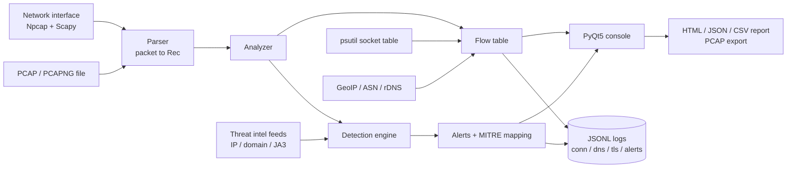

# Network Traffic Analyzer

[](https://github.com/DharunS360/Cybersecurity-BlueTeam-Projects/actions/workflows/08-network-traffic-analyzer.yml)


A real-time **network detection and response (NDR) console** for SOC and blue-team work. It captures live traffic
(or reads a PCAP), tracks every connection as a flow, attributes it to the owning Windows process, enriches it with
GeoIP/ASN and live threat intelligence, and raises **MITRE ATT&CK-mapped alerts** with response guidance.

> Passive monitoring only. It never sends probe traffic and never scans anything, unlike active tools such as Nmap.

## Why this is more than a packet viewer

| Capability | What it gives an analyst |
|---|---|
| **Flow tracking** (Zeek-style) | 5-tuple connections with bytes/packets in each direction, duration, TCP state and closed-flow history |
| **Process attribution** | Every connection mapped to `process.exe` + PID, so "who is talking to this IP?" is answered instantly |
| **TLS visibility** | SNI and **JA3 fingerprint** extracted from the ClientHello, matched against malicious JA3 lists |
| **Enrichment** | Country, ASN, organisation, reverse DNS, and domain names learned from DNS answers and SNI |
| **Live threat intel** | C2 IPs, compromised IPs, malware domains and malicious JA3 hashes, refreshed on every start |
| **Risk scoring** | Per-host risk (0-100) derived from alert severity and shown across flows, destinations and processes |
| **Triage workflow** | Alert detail pane with explanation and response steps, one-click allowlisting, IOC lookup box |
| **Evidence and export** | Save captured packets as PCAP (opens in Wireshark), HTML/JSON/CSV reports, SIEM-ready JSON Lines logs |

## Screenshots

| Overview | Flows with process attribution |
|---|---|
|  |  |

| Alerts with triage guidance | TLS / JA3 |
|---|---|
|  |  |

## Architecture



See [docs/ARCHITECTURE.md](docs/ARCHITECTURE.md) for the module breakdown and data flow.

## Detections

| Detection | Trigger (summary) | Severity | MITRE ATT&CK |
|---|---|---|---|
| Known Malicious IP | Flow endpoint is on a C2 / compromised-host blocklist | Critical | T1071 |
| Malicious Domain | DNS query or TLS SNI listed in URLhaus | Critical | T1071.001 / T1071.004 |
| Malicious JA3 | Client TLS fingerprint listed in SSLBL | High | T1071.001 |
| Port Scan | 20+ distinct ports on up to 3 hosts within 10 s (SYN only) | High | T1046 |
| Network Sweep | SYNs to 20+ internal hosts on up to 3 ports within 10 s | High | T1046 |
| SYN Flood | 300+ SYN packets to one target within 5 s | High | T1498 |
| Beaconing | 8+ connections at near-constant intervals (jitter 20% or less), including DNS beaconing | Medium | T1071 |
| DNS Tunneling | Long or high-entropy subdomains, TXT/NULL abuse, 40+ unique subdomains per minute | Medium / High | T1071.004 |
| Possible DGA | Random-looking second-level domain (entropy, digit/vowel ratio) | Medium | T1568.002 |
| NXDOMAIN Storm | 15+ NXDOMAIN responses within 60 s | High | T1568.002 |
| ARP Spoofing | An IP address changes MAC address | High | T1557.002 |
| Rogue DHCP | DHCP offers from more than one server | High | T1557 |
| ICMP Tunneling | Repeated large ICMP echo payloads | Medium | T1095 |
| Cleartext Credentials | HTTP Basic auth, HTTP POST password fields, FTP/POP3/IMAP login (values never stored) | High | T1552 |
| Large Upload | Single external flow with 50 MB or more sent and 10x more out than in | Medium | T1048 |
| Risky Outbound Port | Outbound SYN to Telnet, SMB, RDP, VNC, MSSQL, MySQL, WinRM, IRC, Tor or known backdoor ports | Medium / High | T1571 |

Exact thresholds, false-positive notes and tuning guidance: [docs/DETECTIONS.md](docs/DETECTIONS.md).

## Quick start (Windows)

**Prerequisites**
- Windows 10/11, Python 3.10 or newer
- [Npcap](https://npcap.com) (install with "WinPcap API-compatible mode" if prompted)

```powershell
git clone https://github.com/DharunS360/Cybersecurity-BlueTeam-Projects.git
cd Cybersecurity-BlueTeam-Projects\08-Network-Traffic-Analyzer
python -m venv .venv
.\.venv\Scripts\Activate.ps1
pip install -r requirements.txt
```

Run from an **Administrator** terminal (needed for packet capture and for seeing all processes):

```powershell
python main.py
```

Or just double-click `run.bat`, which elevates automatically.

## Usage

1. Pick your active network adapter (adapters with an IP address are listed first).
2. Optionally enter a BPF filter, for example `not port 443` or `host 192.168.1.50`.
3. Click **Start Capture**. Use **Load PCAP** instead to analyse a saved capture offline.
4. Work through the tabs:

| Tab | Purpose |
|---|---|
| Overview | Upload/download graph, application mix, top destinations, countries and processes |
| Flows | Active and recently closed connections with process, domain, country, ASN and risk; filter and sort |
| Processes | Per-process connection count, remote hosts, traffic and risk |
| Destinations | Per-remote-host totals with country, organisation and risk |
| TLS / JA3 | SNI, JA3 hash and TLS version for every ClientHello |
| DNS | Queries with responses, NXDOMAIN highlighting and response time |
| Packets | Live packet stream with text filter |
| Alerts | Detections with explanation and response advice; right-click to allowlist |
| ATT&CK | Count of detections per MITRE technique |
| Threat Intel | IOC lookup (IP, domain or JA3) and per-feed load status |

## Data sources

| Source | Used for | Key required |
|---|---|---|
| abuse.ch Feodo Tracker | Botnet C2 IP blocklist | No |
| Emerging Threats compromised IPs | Compromised host IPs | No |
| abuse.ch SSLBL | Malicious JA3 fingerprints | No |
| abuse.ch URLhaus | Malware distribution domains | No |
| ipwho.is | Country / ASN / organisation for public IPs (optional, can be disabled) | No |

Feeds are downloaded on start-up and cached in `data/`. If a feed is unreachable the tool keeps the cached data and
shows the per-feed status in the **Threat Intel** tab.

## Logs and reports

Structured logs are written to `logs/` as JSON Lines (one event per line) so they can be ingested by a SIEM:

| File | Contents |
|---|---|
| `conn.jsonl` | Closed flows (process, endpoints, bytes, duration, state, JA3, risk) |
| `dns.jsonl` | DNS responses (client, query, type, answers, rcode) |
| `tls.jsonl` | TLS ClientHello metadata (SNI, JA3, version, process) |
| `alerts.jsonl` | Alerts (severity, detection, process, MITRE technique, detail) |

**Export Report** writes HTML, JSON and a flows CSV to `reports/`. **Save PCAP** writes the most recent 20,000 captured
packets to `reports/` for deeper analysis in Wireshark.

## Project structure

```
08-Network-Traffic-Analyzer/
  main.py                  PyQt5 console (UI only)
  run.bat                  Auto-elevating launcher
  requirements.txt         Runtime dependencies
  requirements-dev.txt     Test dependencies
  CHANGELOG.md
  core/
    records.py             Rec dataclass (parser output, scapy-independent)
    parser.py              Scapy packet to Rec
    tls.py                 TLS ClientHello parser (SNI + JA3)
    analyzer.py            Flow tracking and detection engine
    intel.py               Threat-intelligence feeds and IOC lookups
    enrich.py              GeoIP/ASN/rDNS enrichment and process mapping
  tests/                   pytest unit tests
  docs/                    Architecture, detection reference, screenshots
```

## Testing

The detection engine, TLS parser and intel feed parser are covered by unit tests that use synthetic records, so they
run without Npcap, administrator rights or internet access:

```powershell
pip install -r requirements-dev.txt
python -m pytest -q
```

Tests run automatically on every push through GitHub Actions.

## Validating detections (your own lab only)

| Detection | Safe way to trigger |
|---|---|
| Port Scan | `nmap -sS -p 1-100 <your-lab-VM>` from another machine you own |
| Cleartext Credentials | `curl -u user:pass http://<your-own-test-server>/` |
| Possible DGA / NXDOMAIN Storm | `nslookup` a batch of random non-existent names against your resolver |
| Beaconing | Loop a request to your own server every 30 s for 5 minutes |

Only test against systems you own or are explicitly authorised to test.

## Limitations

- Windows is the supported platform (process attribution and the launcher are Windows-oriented).
- Encrypted payloads are not decrypted. Detection relies on metadata: SNI, JA3, sizes, timing and DNS.
- TLS 1.3 Encrypted Client Hello hides the SNI, and QUIC (UDP/443) is shown as flows but SNI/JA3 are not extracted.
- Process attribution samples the OS socket table once per second, so very short-lived connections can show as `-`.
- Beaconing is heuristic. Legitimate periodic traffic (updates, telemetry) can match, which is why it is Medium severity
  and should be triaged by an analyst.
- Packet processing runs in Python. It is suited to host and lab monitoring, not multi-gigabit links.

## Privacy and responsible use

- With **Online GeoIP/ASN** enabled, remote public IP addresses are sent to ipwho.is for lookup. Untick the option for
  fully offline operation.
- Cleartext credential values are never stored or logged; only a masked alert is raised.
- Capture and analyse only networks and traffic you own or are authorised to monitor.

## Tech stack

Python 3.10+, PyQt5, PyQtGraph, Scapy, psutil, Requests, pytest

## Author

**Dharun S** - aspiring Blue Team / SOC Analyst. GitHub: [DharunS360](https://github.com/DharunS360)

## License

Released under the MIT License (see the repository root `LICENSE`).