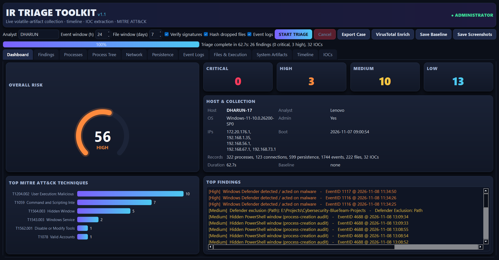
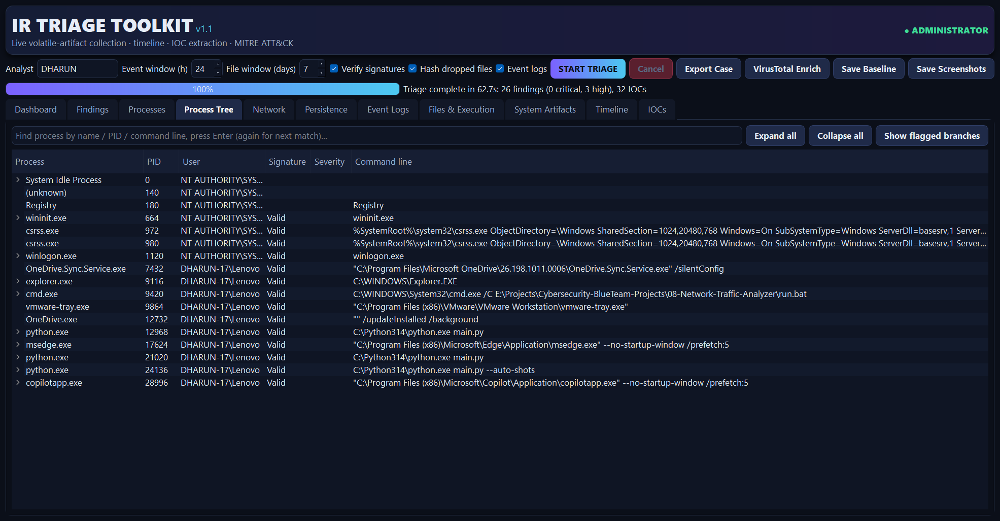
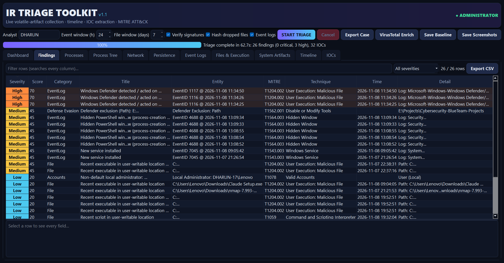

# 09 - Incident Response Triage Toolkit

   

A live **Windows incident-response triage console** for blue teams. It collects volatile and persistent artifacts from the **running host**
(no sample data), applies detection rules mapped to **MITRE ATT&CK**, builds a unified **timeline**, extracts **IOCs** and exports a
forensically-minded **case folder** (HTML report, JSON, CSV, IOC feed, chain of custody, SHA-256 manifest).

| Dashboard | Process tree |
|---|---|
|  |  |
| **Findings** | **HTML case report** |
|  |  |

## What it collects

| Area | Source |
|---|---|
| Processes | `psutil`: image path, command line, parent chain, user, start time, SHA-256, Authenticode signature |
| Network | Live TCP/UDP table mapped to owning process, DNS-cache hostname enrichment, public/private scoping |
| Persistence | Run/RunOnce, Winlogon, AppInit_DLLs, IFEO, cmd AutoRun, Startup folders, Services, Scheduled Tasks, WMI event consumers |
| Event logs | Security (1102, 4624, 4625, 4688, 4697, 4698, 4720, 4728, 4732, 4756), System (7045, 104), PowerShell 4104, Defender (1116, 1117, 5001) |
| Files / execution | Recent executables and scripts in user-writable paths, Prefetch, Recent LNKs |
| System state | Local users and admins, sessions, DNS cache, ARP, SMB shares, hosts file, RDP, firewall profiles, Defender status and exclusions |

## Detection coverage (MITRE ATT&CK)

| Tactic | Examples | Techniques |
|---|---|---|
| Execution | Office spawning shells, encoded PowerShell, download cradles, WMI/IIS spawning shells | T1204.002, T1059.001, T1047, T1505.003 |
| Defense evasion | Process masquerading and look-alike names, LOLBin proxy execution, log clearing, Defender/firewall tampering, double extensions | T1036.005, T1036.007, T1218.x, T1070.001, T1562.001/004 |
| Persistence | Run keys, services, tasks, Winlogon, IFEO, AppInit, WMI subscriptions, Startup folder | T1547.001/004, T1543.003, T1053.005, T1546.003/010/012 |
| Credential access | Credential-dumping command lines and tools, brute force, success-after-failure | T1003, T1110 |
| Command and control | Script hosts / unsigned programs talking to public IPs, suspicious ports, miner pools | T1071, T1571, T1496 |
| Impact / lateral movement | Shadow-copy deletion, RDP/SMB/WinRM exposure, new accounts and group changes | T1490, T1021.x, T1136.001, T1098 |

## Architecture

```
main.py  ->  gui.py (PyQt5 console)  /  --cli
                |
             engine.py   (pipeline: collect -> verify -> analyze)
              |      |
   collectors.py   analysis.py   (rules, ATT&CK map, timeline, IOCs, allowlist, baseline)
                         |
                     report.py   (case export)
```

## Quick start

```powershell
git clone https://github.com/DharunS360/Cybersecurity-BlueTeam-Projects.git
cd Cybersecurity-BlueTeam-Projects\09-Incident-Response-Triage-Toolkit
python -m venv .venv
.\.venv\Scripts\Activate.ps1
pip install -r requirements.txt
python main.py            # GUI
.\run_as_admin.bat        # GUI, elevated (recommended)
python main.py --cli      # headless; exports to .\cases\<HOST>_<timestamp>\
```

Run from an **Administrator** terminal for full coverage. Without it the tool still works but reports that the Security log,
Prefetch and Defender exclusions are unavailable. Optional: set `VT_API_KEY` to enrich hash / IP / domain IOCs with VirusTotal
(free tier: 4 lookups per minute, handled automatically).

CLI options: `--hours`, `--days`, `--no-sig`, `--no-hash`, `--no-events`, `--analyst`, `--out`.

## Case folder

`report.html` · `case_data.json` · `csv/*.csv` · `iocs.csv` · `blocklist_iocs.txt` · `chain_of_custody.txt` · `SHA256SUMS.txt`

## Tuning for your environment

* **Allowlist**: right-click any row -> *Allowlist*, or edit `allowlist.json` (`names`, `paths`, `hashes`, `titles`).
* **Baseline diff**: click *Save Baseline* on a known-good machine; later runs mark `NEW` items and raise findings for new persistence, accounts, shares and listeners.
* Findings are severity-scored (Critical / High / Medium / Low) and the dashboard risk score is capped per severity so a pile of low-signal noise cannot saturate it.

## Design notes and limitations

* Read-only collection; nothing on the host is modified. Evidence files are hashed in the manifest.
* Windows 10/11 only. Process command-line auditing (4688) requires the audit policy to be enabled.
* Signature checks use `Get-AuthenticodeSignature`; catalog-signed files are reported as `Valid`.
* Heuristics are not verdicts: validate findings before acting. Use the allowlist to encode what is normal for your estate.

## Tests

```powershell
python -m unittest discover -s tests -v
```
The collectors read the live host, so the unit tests feed hand-built artifact rows into the detection engine to prove each rule fires and that benign defaults stay quiet.

## Responsible use

Run only on systems you own or are explicitly authorised to examine.
