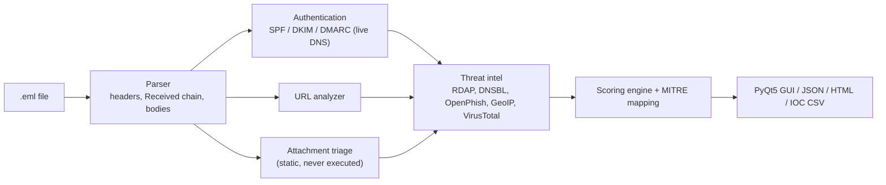

# PhishScope - Phishing Email Analyzer


A phishing-triage workstation for SOC analysts. Load a `.eml` and PhishScope returns a 0-100 risk verdict, e-mail
authentication results **computed from live DNS**, IP / domain / URL / file reputation from **real threat-intel
sources**, and an analyst-ready IOC list mapped to MITRE ATT&CK. It runs as a desktop GUI or as a CLI for scripting.

<!-- Add screenshots to docs/screenshots/ then uncomment:


-->

## Features

| Area | What it does |
|------|--------------|
| **SPF** | Full RFC 7208 evaluation of the delivering IP: `include`, `a`, `mx`, `ip4`, `ip6`, `exists`, `redirect`, 10-lookup limit, weakness checks (`+all`, multiple records) |
| **DKIM** | Real cryptographic verification (dkimpy), public-key lookup, key-strength estimate, revoked/test-mode keys, signed-header and alignment checks |
| **DMARC** | Policy discovery with organizational-domain fallback, relaxed/strict SPF and DKIM alignment, `p`, `sp`, `pct`, reporting URIs |
| **Routing** | Received-chain parsing, per-hop delay, origin and delivering IP, GeoIP / ASN / proxy flags, Spamhaus ZEN and SpamCop DNSBL |
| **Sender identity** | Display-name spoofing, brand impersonation, Reply-To and Return-Path mismatch, RDAP domain age, Spamhaus DBL |
| **URLs** | Link-text vs destination mismatch, punycode / homograph, lookalike and brand-in-host detection, shorteners, open redirects, raw-IP hosts, OpenPhish live feed, VirusTotal |
| **Attachments** | Hashes, magic-byte vs extension, double extension, RLO spoofing, OLE and OOXML macros, remote template injection, PDF JavaScript / Launch, HTML smuggling, encrypted archives, VirusTotal |
| **Output** | Risk gauge, MITRE ATT&CK mapping, defanged IOCs, JSON, self-contained HTML report, IOC CSV |

## Architecture



## Scoring

Each finding carries a weight. The score is the capped sum (max 100).

| Score | Verdict |
|-------|---------|
| 0-19 | Low risk |
| 20-39 | Suspicious |
| 40-64 | Likely phishing |
| 65-100 | Malicious / phishing |

A hit on the OpenPhish feed or 5+ VirusTotal detections raises the score to at least 85. Messages that pass SPF, DKIM
and DMARC are not penalized for sending from cloud or hosting IPs, which avoids false positives on mail from large providers.

## MITRE ATT&CK coverage

| Technique | Detected through |
|-----------|------------------|
| T1566.001 Spearphishing Attachment | Malicious attachment indicators |
| T1566.002 Spearphishing Link | Suspicious URLs |
| T1598 Phishing for Information | Embedded credential forms |
| T1656 Impersonation | Display-name / brand spoofing, DMARC alignment failure |
| T1036.002 / .007 / .008 Masquerading | RLO, double extension, file-type mismatch |
| T1204.001 / .002 User Execution | Links, executables, macros |
| T1059.005 Visual Basic | VBA macro projects |
| T1221 Template Injection | Remote OOXML templates |
| T1027.006 HTML Smuggling | `atob` + `Blob` download pattern |
| T1583.001 Acquire Infrastructure: Domains | Newly registered sender / URL domains |

## Installation

Requires Python 3.10+ (tested on Windows 10/11).

```powershell
git clone https://github.com/DharunS360/Cybersecurity-BlueTeam-Projects.git
cd Cybersecurity-BlueTeam-Projects\10-Phishing-Email-Analyzer
python -m venv .venv
.\.venv\Scripts\Activate.ps1
pip install -r requirements.txt
```

## Usage

```powershell
# GUI (drag and drop an .eml, or Ctrl+O)
python main.py
python main.py suspicious.eml

# CLI
python main.py suspicious.eml --cli --html report.html --json result.json --ioc iocs.csv
```

`run.bat` creates the virtual environment on first run and launches the GUI.

To get a real sample from Gmail: open the message, choose **More (three dots) > Download message**.

## Configuration

No key is required for SPF, DKIM, DMARC, DNSBL, RDAP, GeoIP or the OpenPhish feed. VirusTotal lookups are optional:

- set the `VT_API_KEY` environment variable, or
- enter the key under **Settings** in the GUI (stored in a local, git-ignored `config.json`).

The free VirusTotal tier allows 4 requests per minute, so the number of URLs checked is capped (default 4).

## Project structure

```
10-Phishing-Email-Analyzer/
  main.py              entry point (GUI and CLI)
  core/
    emailparse.py      headers, Received chain, bodies
    authcheck.py       SPF evaluator, DKIM verification, DMARC
    urls.py            URL extraction and heuristics
    attach.py          static attachment triage
    intel.py           GeoIP, RDAP, DNSBL, OpenPhish, VirusTotal
    scoring.py         findings, verdict, MITRE mapping
    engine.py          orchestration
    report.py          JSON / HTML / CSV export
  gui/                 PyQt5 interface
  tests/               offline unit tests
```

## Testing

```powershell
python -m unittest discover -s tests -v
```

All network calls are mocked, so the 27 tests run offline and are executed in CI on every change to this folder.

## Privacy and limitations

- Analysis is **static**. Attachments are parsed as bytes and never executed; HTML bodies are never rendered and links are shown defanged.
- Lookups send data to third parties: sender IPs go to ip-api.com (free tier is HTTP, unencrypted) and DNS blocklists; domains go to RDAP and Spamhaus; hashes and URLs go to VirusTotal if enabled. Do not analyze confidential mail with these lookups on.
- The SPF check uses the last external IP found in the Received chain, which may differ from the connecting IP your own gateway saw. Header results recorded by the receiving server take precedence when present.
- DKIM verification requires the message to be unmodified since signing. SPF macros and the `ptr` mechanism are not evaluated.
- Heuristic scoring can produce false positives (bulk mailers often use a different Return-Path) and misses (a well-aged compromised account passes all checks). Treat the verdict as triage support, not a final decision.
- `.msg` files are not supported; export to `.eml` first.

## Responsible use

Built for defensive and educational purposes. Analyze only mail you own or are authorized to assess.

## License

MIT (see the repository root).
